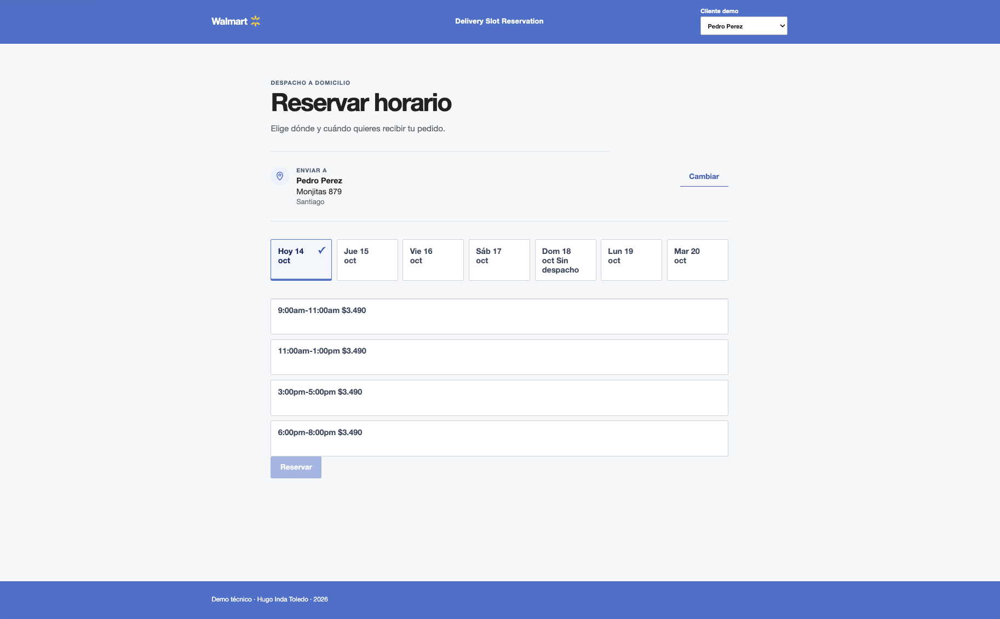

# 🛍️ Walmart Chile · Reserva de horarios de despacho (web)

> Elige tu dirección, escoge un día y un bloque horario, y reserva tu despacho. Con cuenta regresiva para confirmar.



Aplicación web (SPA) que consume la [API de reservas](https://github.com/hugo-inda-toledo/walmart-cl-slot-reservation-api)
por HTTP. Se compila, prueba y empaqueta usando solo el contenido de este repositorio.

| 🧱 Pieza                   | Tecnología                                                                                         |
| -------------------------- | -------------------------------------------------------------------------------------------------- |
| **Interfaz**               | React 19 + TypeScript + Vite                                                                       |
| **Servidor en contenedor** | Nginx sin root, con proxy `/api` hacia la API                                                      |
| **Pruebas**                | Vitest (unitarias y componentes) + Playwright (E2E contra la API real, con accesibilidad WCAG 2.2) |

**Ir a:** [🚀 Inicio rápido](#-inicio-rápido) · [👀 Recorrido](#-recorrido-en-el-navegador) · [🧪 Pruebas](#-pruebas) ·
[❓ FAQ](#-preguntas-frecuentes) · [📚 Más documentación](#-más-documentación)

---

## 📋 Requisitos

| Herramienta           | Versión              | Para qué                             | Comprobar          |
| --------------------- | -------------------- | ------------------------------------ | ------------------ |
| 🐳 Docker con Compose | Engine API ≥ 1.44    | Levantar la web con un comando       | `docker --version` |
| 🟢 Node.js            | ≥ 22.12 (fijada: 24) | Solo para desarrollo y pruebas       | `node --version`   |
| 🔌 API de reservas    | —                    | La web **necesita** la API corriendo | ver el paso 1      |

> 🐳 **¿`docker compose` o `docker-compose`?** Según cómo instalaste Docker (Docker Desktop, Colima, Homebrew) el
> comando se llama distinto. Comprueba cuál tienes:
>
> | Si esto funciona…        | Usa en toda la guía            |
> | ------------------------ | ------------------------------ |
> | `docker compose version` | `docker compose …`             |
> | `docker-compose version` | `docker-compose …` (con guion) |
>
> Los comandos de este README usan `docker compose`; si tienes el otro, cambia el espacio por un guion.

---

## 🚀 Inicio rápido

> ⏱️ Primera vez: unos **2–5 minutos** (descarga y build). Después, segundos.

**1️⃣ Levanta primero la API** (esta web no funciona sin ella):

```bash
git clone https://github.com/hugo-inda-toledo/walmart-cl-slot-reservation-api.git
cd walmart-cl-slot-reservation-api
docker compose up --build -d --wait
cd ..
```

Más detalle en el [README de la API](https://github.com/hugo-inda-toledo/walmart-cl-slot-reservation-api).

**2️⃣ Clona esta web y entra a la carpeta**

```bash
git clone https://github.com/hugo-inda-toledo/walmart-cl-slot-reservation-website.git
cd walmart-cl-slot-reservation-website
```

**3️⃣ Levántala con un solo comando**

```bash
docker compose up --build -d --wait   # si dice "unknown flag: --build", usa: docker-compose up --build -d --wait
```

**4️⃣ Prueba de humo** (debe imprimir líneas `OK`):

```bash
./scripts/smoke-fullstack.sh
```

**5️⃣ Ábrela:** http://localhost:8081 🎉

| Quiero…                | Comando                                     |
| ---------------------- | ------------------------------------------- |
| Detener                | `docker compose down`                       |
| Ver logs               | `docker compose logs -f web`                |
| Cambiar el puerto 8081 | `WEB_PORT=9000 docker compose up -d --wait` |

---

## 👀 Recorrido en el navegador

1. Abre http://localhost:8081, deja el cliente demo (o elige otro) y pulsa **Elegir dirección**.
2. Elige **Monjitas 879, Santiago**: se cargan fechas y bloques.
3. Prueba **La Serena**: las fechas marcadas **Agotado** no se pueden seleccionar.
4. Elige fecha y bloque y pulsa **Reservar**. ⏳ _La retención se crea recién aquí, no al elegir el bloque_, y
   aparece una cuenta regresiva.
5. Pulsa **Confirmar** para completar la reserva ✅.
6. Para ver una ventana llena con alternativas, ejecuta el bucle `SLOT_FULL` del
   [recorrido de la API](https://github.com/hugo-inda-toledo/walmart-cl-slot-reservation-api/blob/main/docs/recorrido-curl.md).
7. **Av. Pajaritos 2000, Maipú** muestra "zona inactiva" y permite cambiar la dirección 📭.

Direcciones y clientes demo en [🎭 datos demo](docs/datos-demo.md).

---

## 🧪 Pruebas

| Alcance                            | Comando                              | Resultado esperado            |
| ---------------------------------- | ------------------------------------ | ----------------------------- |
| Todo (lint, tipos, pruebas, build) | `npm ci && npm run verify`           | Todo verde                    |
| E2E contra la API real             | `npm run e2e:install && npm run e2e` | Pasan (API arriba en `:8080`) |
| Smoke full-stack                   | `./scripts/smoke-fullstack.sh`       | Líneas `OK`                   |

Detalle, precondiciones y qué cubre cada una en [🧪 pruebas E2E](docs/pruebas-e2e.md).

---

## ❓ Preguntas frecuentes

<details><summary><b>La página carga pero no aparecen direcciones / veo "Reintentar"</b></summary>

La API no está levantada o no es alcanzable (el proxy `/api` responde 502). Levanta la API primero y pulsa
**Reintentar**. Compruébalo con `curl http://localhost:8080/actuator/health/readiness`.
</details>

<details><summary><b>Me sale <code>unknown flag: --build</code> al levantar</b></summary>

Tu Docker no tiene el plugin `docker compose` y solo tiene `docker-compose` (con guion). Usa:
`docker-compose up --build -d --wait`.
</details>

<details><summary><b>El puerto 8081 está ocupado</b></summary>

Cambia el puerto: `WEB_PORT=9000 docker compose up --build -d --wait` (queda en http://localhost:9000), o libera el
8081 (`lsof -i :8081`).
</details>

<details><summary><b>La API corre en otro puerto o en otra máquina</b></summary>

Define `API_UPSTREAM`, por ejemplo `API_UPSTREAM=http://host.docker.internal:9090 docker compose up --build -d --wait`.
Variables en [⚙️ configuración](docs/configuracion.md).
</details>

<details><summary><b>Uso Linux y no resuelve <code>host.docker.internal</code></b></summary>

El compose ya incluye `extra_hosts: host.docker.internal:host-gateway`. Si un firewall lo impide, define
`API_UPSTREAM` con una URL alcanzable.
</details>

<details><summary><b><code>npm ci</code> falla por la versión de Node</b></summary>

El proyecto exige Node ≥ 22.12 (`engine-strict`). Usa la versión fijada: `nvm use` (lee `.nvmrc`, Node 24).
</details>

<details><summary><b>Los E2E dicen que la API no responde</b></summary>

Levanta la API antes (`docker compose up --build -d --wait` en su repo) y repite `npm run e2e`.
</details>

<details><summary><b>¿Cómo desarrollo con recarga en caliente?</b></summary>

`npm ci && npm run dev` (http://localhost:5173). Más en [🧑‍💻 desarrollo local](docs/desarrollo.md).
</details>

---

## 📚 Más documentación

| Documento                                            | Contenido                                         |
| ---------------------------------------------------- | ------------------------------------------------- |
| [🧑‍💻 Desarrollo local](docs/desarrollo.md)            | `npm run dev`, proxy y tabla completa de comandos |
| [⚙️ Configuración](docs/configuracion.md)            | Variables de entorno y notas de seguridad         |
| [🧪 Pruebas E2E](docs/pruebas-e2e.md)                | Cómo correrlas y qué cubren                       |
| [📜 Contrato de la API](docs/contrato.md)            | Copia versionada de OpenAPI y sincronización      |
| [🐳 Imagen de contenedor](docs/imagen-contenedor.md) | `docker build/run`, Nginx y proxy                 |
| [🔁 Integración continua](docs/ci.md)                | Workflows y configuración de GitHub               |
| [🎭 Datos demo](docs/datos-demo.md)                  | Clientes y direcciones de demostración            |

---

📄 Licencia: [MIT](LICENSE)
